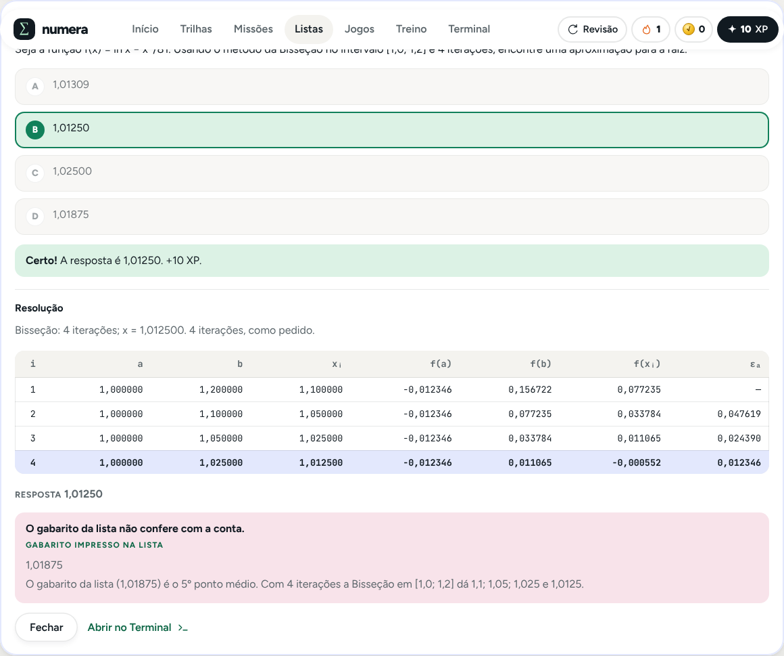
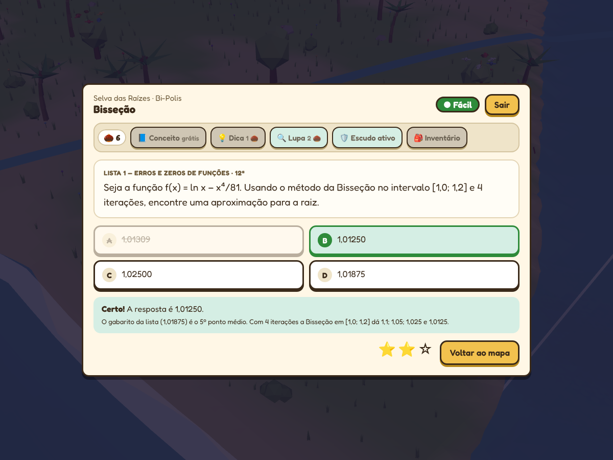
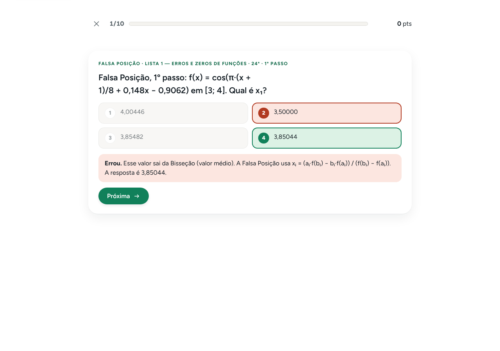
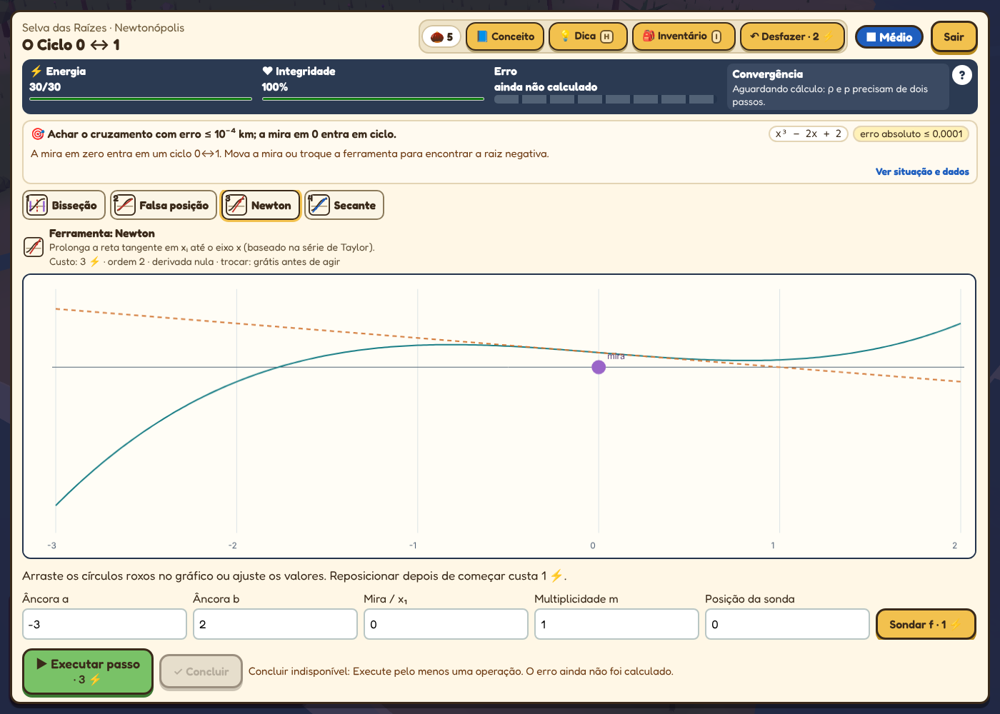

# Numera Academy

Jogo e laboratório de **métodos numéricos** para a disciplina de Modelagem Computacional. Num só site:

- **Jornada:** seis métodos (Bisseção, Falsa Posição, Newton-Raphson, Secante, Eliminação de Gauss e Gauss-Seidel) em mundos do mais fácil ao mais difícil, com lições, simulações, missões, moedas e **Raiz e Pivô**, o casal de mascotes que torce durante os desafios. O conteúdo segue os slides da professora (Cap. 2 e Cap. 3): mesma notação, mesmas tabelas e mesmos exemplos.
- **Listas:** os Testes 1 a 6 e as listas da disciplina num **banco de questões em SQL** ([`banco-de-questoes/`](banco-de-questoes/README.md)), com correção na hora, resolução no formato dos slides e explicação quando o gabarito impresso não confere com a conta. Questão errada vai para a **Revisão**.
- **Jogos:**
  - **Relâmpago:** 10 perguntas rápidas de múltipla escolha, com cronômetro e combo, e o modo **Caça ao Bug Numérico** (ache a célula errada da tabela).
  - **Calculândia — Caçadores de Raízes:** aventura 3D com 63 fases, 21 métodos, cinco chefões e a Usina. Todas as perguntas usam a mesma tela: casa verde com múltipla escolha básica, casa azul com os Testes e as listas da Profa. Danielle e casa vermelha com as listas de Cálculo Numérico, as duas com o **terminal** para digitar a conta. No fim, os três reatores da Usina (Bisseção com 10 iterações, Gauss 4×4 e Newton com 6 iterações) e a explosão.
  - **Bobo da Corte** (antigo Quem Divergiu?): jogo de sala para o telão. Cada aluno faz um palpite em segredo, a turma vota em quem divergiu e o mais votado vira o **Bobo da Corte** da rodada, com cortina, dança e roleta de prendas.
- **Laboratório** (aberto pelo Terminal): arraste o x₀ e veja para qual raiz o Newton vai (bacias de convergência), a **Corrida de Convergência**, troque linhas de um sistema até ele convergir (Sassenfeld), teste a sensibilidade (κ) e resolva dois fenômenos (comporta e treliça).
- **Treino de diagnóstico** com 120 exercícios, **modo prova** e um **Terminal** que mostra cada passo do cálculo, com a aba **Slides** (tabela no formato da professora), o **Modo Lousa** (a tabela construída célula por célula) e gráfico de convergência.

É um site estático: HTML, CSS e JavaScript puros, sem build, sem servidor, sem conta e sem rastreadores. Funciona offline e pode ser instalado como app.

**Versão 14** · [Mapa do projeto (onde fica cada arquivo)](MAPA-DO-PROJETO.md) · [O que mudou](CHANGELOG.md) · [Banco de questões](banco-de-questoes/README.md) · [Relatório técnico](docs/RELATORIO-TECNICO.md) · [Roteiro de apresentação](docs/APRESENTACAO.md) · [Qualidade](docs/QUALIDADE.md) · [Calculândia](docs/calculandia/README.md)

| Listas: resolução no formato dos slides e o gabarito da lista que não confere | Calculândia: a casa verde com os dispositivos no topo |
|---|---|
|  |  |
| **Relâmpago:** pergunta rápida com cronômetro | **Calculândia:** a tela mais limpa das casas azul e vermelha |
|  |  |

**Vídeo-resumo da Calculândia:** [`/video/`](https://modelagem-computacional.vercel.app/video/) (arquivo em `dist/video/calculandia-resumo.mp4`), da abertura à explosão da Usina, gravado do próprio jogo.

## Evolução pedagógica

O Terminal agora inclui **malha térmica**, **drone com polinômio versus spline**, **régua de mantissa**, **interpolação/ajuste/integração** e um **Ponto Fixo opcional** em Pesquisa avançada. Gráficos táteis e troca de linhas usam os dados digitados; as Trilhas e Missões abrem os experimentos. Na Calculândia, há habilidades dos pets, desafios opcionais dos mestres e fenômenos ligados aos passos da Usina.

[Guia, cobertura do plano e modelos utilizados](docs/EVOLUCAO-PEDAGOGICA.md).

## Abrir

```bash
node serve.js            # ou: npm run servir
```

Abra http://localhost:8000. O site também abre direto do disco (`dist/index.html`), mas a Calculândia usa módulos ES e precisa de um endereço `http(s)`: pelo `serve.js`, por `python3 -m http.server 8000 -d dist` ou publicado no GitHub Pages ([como publicar](#publicar)).

| Endereço | O que abre |
|---|---|
| `/` | Numera Academy (início, trilhas, missões, listas, jogos, Treino, Terminal) |
| `/#listas` | as questões das listas (banco de questões) |
| `/#relampago` | modo Relâmpago |
| `/#jogos` | página Jogos, com o progresso salvo de cada jogo |
| `/jogos/calculandia/` | Calculândia (3D) |
| `/#laboratorio` | Laboratório (tátil, troca de linhas, sensibilidade e fenômenos) |
| `/video/` | vídeo-resumo da Calculândia (o resumão) |
| `/jogos/bobo-da-corte/` | Bobo da Corte (telão da sala); `/jogos/quem-divergiu/` redireciona para cá |

## O que tem

| Parte | Conteúdo |
|---|---|
| **Jornada (Trilhas)** | 6 mundos em ordem de dificuldade (★ a ★★★★★), cada um com 12 etapas em três níveis, leitura guiada, aulas em vídeo e simulação passo a passo. O Nível 1 de um mundo abre o próximo; o **modo livre** abre tudo |
| **Raiz e Pivô** | mascotes que dançam durante os desafios; a cada **3 acertos seguidos**, o Pivô soca a caixa Σ e caem moedas |
| **Missões** | 6 problemas aplicados em três etapas: formular, calcular e interpretar |
| **Listas** | 468 questões (Testes 1 a 6, 4ª e 5ª Listas da Profa. Danielle, Listas 1 a 10, perguntas dos slides, de conceito e básicas de cada método), com filtro por lista e por assunto, resposta digitada ou alternativas, resolução no formato dos slides e observação quando o gabarito da lista não confere |
| **Relâmpago** | 10 perguntas rápidas por rodada, com cronômetro, combo de até ×3 e recorde; atalhos 1–4 e Enter. Modo **Caça ao Bug**: 8 tipos de tabela com um erro plantado (metade errada na Bisseção, valor velho no Seidel, b esquecido no Gauss, sinal do Newton…) |
| **Jogos** | **Relâmpago**, **Calculândia** (aventura 3D, para jogar sozinho) e **Bobo da Corte** (jogo de sala, para a turma inteira) |
| **Laboratório** | aba Tátil (arraste x₀, x₀ e x₁ ou [a, b] no gráfico e veja as 3 primeiras iterações; bacias de convergência do Newton), Corrida de Convergência entre os métodos, troca de linhas com o medidor de Sassenfeld, botão **Testar sensibilidade** (ruído de 1% no b e o número de condição κ) e o Simulador de Fenômenos (a comporta da barragem e a treliça da ponte, que balança e cai com as equações fora de ordem) |
| **Treino** | 120 problemas misturados: diagnosticar o método, resolver e conferir, com **369 erros típicos** reconhecidos |
| **Modo prova** | 5, 10 ou 15 questões, cronômetro, nota de 0 a 10 e relatório em PDF |
| **Terminal** | equações e sistemas lineares, intervalo [a, b] do exercício, teclado científico, comparação de métodos, aba **Slides** (tabela no formato da professora, com o **Modo Lousa** e o destaque do pivô no Gauss), aba Convergência e verificação da raiz; Raiz e Pivô reagem ao método (tesoura na Bisseção, soco no Gauss, transferidor quando a calculadora parece estar em graus) |
| **Progresso** | XP, moedas, 12 conquistas (2 delas pelos jogos), camarim e backup em JSON |

### Calculândia: casas, chefões e o final

| Casa | Pergunta |
|---|---|
| 🟢 Verde | múltipla escolha básica de Cálculo Numérico (4 por método) |
| 🔵 Azul | Testes 1 a 6 e listas da Profa. Danielle, no **terminal**: digite a conta (`(0.5+1)/2`, `f(1.25)`, `ans`) e Enter envia |
| 🔴 Vermelha | Listas de Cálculo Numérico, no terminal, ou a **Caça ao Bug** (clique na célula errada) |
| Chefão | barra de vida e 3 corações; cada golpe é uma pergunta, e o último é o **Método Híbrido**: ache a raiz com até 8 avaliações misturando Bisseção, Secante e Newton |
| Usina | 3 reatores: Bisseção com 10 iterações, Eliminação de Gauss 4×4 (os 6 multiplicadores e a substituição) e Newton com 6 iterações. Vencendo, a Usina explode, a névoa some e vem a festa final |

Em todas as perguntas: no máximo 4 iterações, Lupa (no terminal, troca por alternativas), resolução completa depois de responder e o botão 🧪 **Laboratório** para abrir o simulador antigo.

### Bobo da Corte em sala

1. **Monte a turma:** até 12 nomes, ou times (Fileira 1, Fileira 2…). Escolha os temas que a turma já viu, a dificuldade, o número de rodadas e a prenda (toda rodada, só no fim ou sem prenda).
2. **Palpite em segredo:**
   - **Telão:** cada um escreve o número no caderno, com relógio opcional.
   - **Passa o aparelho:** cada um digita escondido, na sua vez.
3. **Voto:** cada jogador aponta quem ele acha que chutou mais longe. Os votos aparecem juntos.
4. **Revelação:** a resposta cai na reta numérica, com as faixas de erro relativo de 1%, 5% e 20%.
   - Quem mais se aproximou leva o carimbo CONVERGIU; quem mais se afastou, DIVERGIU.
   - O botão "Como se calcula" mostra o passo a passo no quadro.
5. **O Bobo da Corte:** o mais votado vira o bobo da rodada. A cortina abre, o holofote acende, o bobo dança e a roleta sorteia uma prenda leve de sala (explicar o método como narrador de futebol, imitar a Bisseção andando pela sala…). Quem foi votado sem ter divergido ganha o selo de injustiçado.

Rodadas especiais (dá para desligar nos ajustes):
- **🎰 Bolão da Convergência** (a cada 3 rodadas): antes da pergunta, cada um aposta se a Bisseção ou a Falsa Posição chega antes; quem acerta ganha ×1,5 nos pontos da rodada.
- **🌪️ Perturbação da Épsilon** (depois de um sistema linear): soma 0,01 no b₁; a turma diz se a solução quase não muda ou muda tudo, e o κ∞ explica.
- **✨ Na mosca:** palpite com 4 decimais certos ganha +25.

Pontos: até 1% de erro vale 100, até 5% vale 60, até 20% vale 30 e até 50% vale 10. Há bônus para quem acertar o voto (+30), para quem chegar mais perto (+20), para quem foi votado sem ter divergido (+20) e na mosca (+25). No fim, pódio, títulos (Olho de Newton, Na mosca, Detetive do erro, Mais divergente, Alvo da turma) e a prenda do Bobo da partida.

São 30 perguntas próprias, os 23 desafios numéricos da antiga Arena (como "relâmpago") e as questões numéricas das listas (banco de questões; dá para desligar nos ajustes). As respostas são **calculadas**, nunca digitadas, e conferidas nos testes contra o motor do site.

## Organização

Cada pasta tem um assunto e cada arquivo tem o nome do que faz. O [Mapa do projeto](MAPA-DO-PROJETO.md) lista tudo, arquivo por arquivo, e traz a tabela dos nomes antigos para os novos.

```text
banco-de-questoes/            as questões das listas em SQL (questoes.sql) e o gerador do arquivo do site
dist/                         o site (o que o navegador abre)
  index.html                  página do site
  css/                        estilos (site, listas, terminal, treino, personagens…)
  js/motor/                   métodos numéricos, formato dos slides, resolvedor das questões e Caça ao Bug
  js/conteudo/                textos das lições e exemplos dos slides
  js/paginas/                 uma página por arquivo (início, trilhas, lição, listas, relâmpago, terminal, laboratório…)
  js/site/                    moldura, estado, desenhos, eventos e Modo Lousa
  js/personagens/             Raiz e Pivô
  dados/                      dados gerados (banco-de-questoes.js, treino-exercicios.js)
  jogos/calculandia/          Calculândia: index.html, estilo.css, codigo/ (dados, fases, interface, personagens, mundo, sistemas)
  jogos/bobo-da-corte/        Bobo da Corte: index.html, bobo-da-corte.js, perguntas.js
  video/                      vídeo-resumo da Calculândia (página e MP4, fora do cache offline)
docs/                         relatório técnico, apresentação, qualidade, Calculândia e documentos organizacionais
tests/                        testes automáticos (verify, banco, calculandia, e2e, treino, terminal, pwa)
previews/                     capturas de tela
serve.js                      servidor local sem dependências
```

## Testes

```bash
npm run testar               # verify + banco de questões + gabarito do Treino + cache offline + regras da Calculândia
npm run servir               # em outro terminal, para os testes de navegador
npm run testar-navegador     # compatibilidade, fluxos, offline e acessibilidade (Playwright: cd tests/e2e && npm ci)
npm run testar-calculandia   # Calculândia no navegador: as 69 montagens de fase, as perguntas, os chefões, a Usina e o alcance do mapa
```

| Suíte | O que confere |
|---|---|
| `tests/verify.cjs` | motor, conteúdo, formato dos slides, progresso, interface (DOM simulado), Treino, prova, PWA, página Jogos, Laboratório, Modo Lousa, Caça ao Bug e Bobo da Corte |
| `tests/banco/conferir-banco.cjs` | as 468 questões refeitas pelo resolvedor do site, alternativas (4, uma certa, cada errada explicada), observação em todo gabarito da lista que não confere, a casa de cada questão e o número de iterações |
| `tests/treino/conferir-com-motor.cjs` | os 140 gabaritos do Treino refeitos pelo motor |
| `tests/calculandia/rules.test.mjs` | regras das 63 fases, chefões, Usina, bateria, estrelas e XP |
| `tests/calculandia/browser-smoke.cjs` e `world-reach.cjs` | todas as fases abrem no navegador, as casas trazem a pergunta (múltipla escolha, terminal e Caça ao Bug), chefão com o Método Híbrido, os três reatores da Usina, vitória e derrota salvas, portas alcançáveis a pé |
| `tests/e2e/testar-fluxos.mjs` | fluxos completos do site, inclusive Listas, Revisão e Relâmpago, a página Jogos e o Bobo da Corte |
| `tests/e2e/testar-offline.mjs` | o site e os jogos abrem sem internet |
| `tests/e2e/auditar-a11y.mjs` | axe-core, WCAG 2.1 AA, no modo claro e no escuro, inclusive Listas e Relâmpago |
| `tests/e2e/testar-webkit.py` | motor do Safari (WebKit) |
| `tests/e2e/checar-compat.mjs` | ES2021 e recursos suportados (site e Bobo da Corte: Safari 15+; Calculândia: módulos ES) |

Antes de enviar uma mudança, rode `npm run atualizar`: ele acerta o número de verificações mostrado no site e a versão do cache offline. Mudou o `questoes.sql`? Rode `npm run banco` antes.

## Publicar

O repositório não tem mais workflows do GitHub Actions. Para ver o site, baixe o repositório e rode `npm run servir`. Para publicar no GitHub Pages, é preciso um workflow que publique a pasta `dist/` (o Pages, sem workflow, só publica a raiz ou a pasta `docs/`). Repositório privado: o GitHub Pages exige um plano pago.

## Ponto Fixo escondido por enquanto

A professora pediu para tirar o Ponto Fixo por enquanto. Em `dist/js/conteudo/conteudo.js`, a linha `C.HIDDEN=['fixedpoint'];` o tira das trilhas, das missões, do Treino, do Terminal e do Bobo da Corte. Para trazê-lo de volta:

1. troque a linha por `C.HIDDEN=[];`;
2. rode `npm run atualizar`.

## Navegadores

| Parte | Mínimo | Testado de verdade |
|---|---|---|
| Site (com Listas, Relâmpago e Laboratório) e Bobo da Corte | Chrome/Edge 90+, Firefox 90+, Safari 15+ (iOS 15+) | Chromium e WebKit (motor do Safari) |
| Calculândia (3D) | WebGL 2 e Chrome/Edge 98+, Firefox 94+, Safari 15.4+ | Chromium (WebGL por software) |

O Firefox foi verificado por análise estática. Detalhes em [docs/QUALIDADE.md](docs/QUALIDADE.md).

## Dados e privacidade

Tudo fica no `localStorage` do navegador; nada é enviado para servidor:

| Chave | Parte |
|---|---|
| `numera-academy-v4` | trilhas, missões e questões das listas (acertos e Revisão) |
| `numera-relampago-v1` | Relâmpago: recorde e número de rodadas |
| `numera-treino-v9` | Treino |
| `calculandia-save-v1` | Calculândia |
| `calculandia-perguntas-vistas-v1` | Calculândia: últimas perguntas das casas, para não repetir |
| `numera-bobo-da-corte-v1` | Bobo da Corte: nomes da turma, ajustes, número de partidas e bobos (lê o antigo `numera-quem-divergiu-v1` na primeira vez) |

Fontes, Three.js e imagens vêm do próprio site. A única coisa de fora são as aulas do YouTube: o player só carrega quando você clica em "Assistir aqui".

## Créditos

- **Numera Academy** e **Bobo da Corte:** Cauã De Angelis (Engenharia de Computação, Ibmec), para Modelagem Computacional.
- **Conteúdo e questões:** slides do Cap. 2 e do Cap. 3, os Testes 1 a 6 e a 4ª e a 5ª Listas da Profa. Danielle Teixeira; Listas 1 a 10 de Cálculo Numérico (UERJ).
- **Calculândia:** Igor Mariano.
- **Personagens:** Raiz, Pivô, a Épsilon (a apresentadora do Bobo da Corte), o bobo e os alunos são desenhos originais em SVG.
- **Bibliotecas:** Three.js (MIT) e as fontes Figtree, Newsreader, JetBrains Mono e Fredoka (SIL OFL), com as licenças junto dos arquivos.

Fórmulas e condições dos métodos conferidas nas referências do [relatório técnico](docs/RELATORIO-TECNICO.md).
