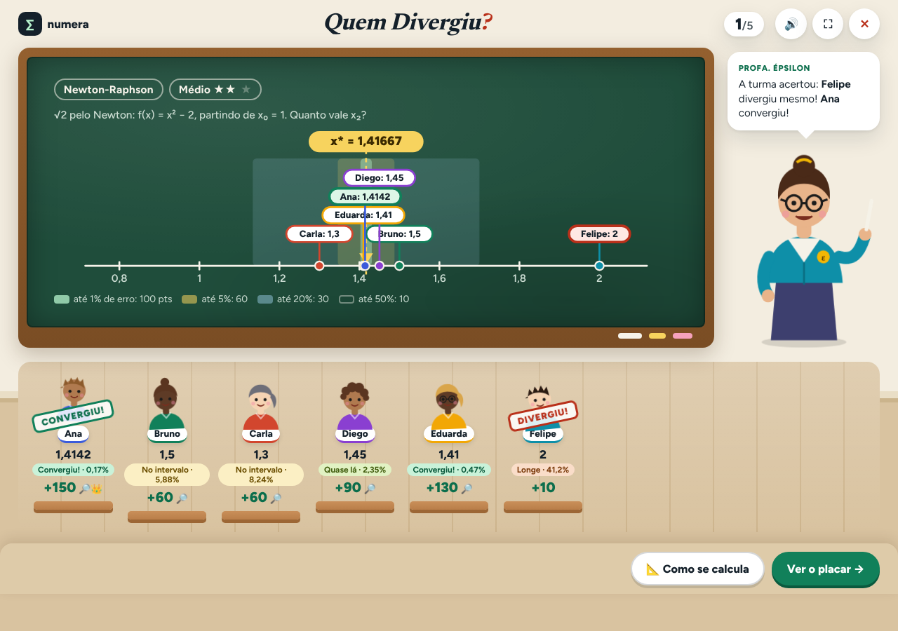

# Numera Academy

Jogo e laboratório de **métodos numéricos** para a disciplina de Modelagem Computacional. Num só site:

- **Jornada:** seis métodos (Bisseção, Falsa Posição, Newton-Raphson, Secante, Eliminação de Gauss e Gauss-Seidel) em mundos do mais fácil ao mais difícil, com lições, simulações, missões, moedas e **Raiz e Pivô**, o casal de mascotes que torce durante os desafios.
- **Jogos** (no lugar da antiga Arena):
  - **Calculândia — Caçadores de Raízes:** aventura 3D com 63 fases táticas, 21 métodos, cinco chefões e a Usina.
  - **Quem Divergiu?:** jogo de sala para o telão. A professora projeta uma pergunta com resposta numérica, cada aluno faz um palpite em segredo, a turma vota em quem divergiu e a reta numérica revela a resposta com as faixas de tolerância.
- **Treino de diagnóstico** com 120 exercícios, **modo prova** e um **Terminal** que mostra cada passo do cálculo, com gráfico de convergência.

É um site estático: HTML, CSS e JavaScript puros, sem build, sem servidor, sem conta e sem rastreadores. Funciona offline (os dois jogos também) e pode ser instalado como app.

**Versão 12** · [O que mudou](CHANGELOG.md) · [Relatório técnico](docs/RELATORIO-TECNICO.md) · [Roteiro de apresentação](docs/APRESENTACAO.md) · [Qualidade](docs/QUALIDADE.md) · [Calculândia: documentação do jogo](docs/calculandia/README.md)



## Abrir

```bash
node serve.js            # ou: npm run servir
```

Abra http://localhost:8000. O site também abre direto do disco (`dist/index.html`), mas a Calculândia usa módulos ES e precisa de um endereço `http(s)`: pelo `serve.js`, por `python3 -m http.server 8000 -d dist` ou publicado no GitHub Pages ([como publicar](#publicar-no-github-pages)).

| Endereço | O que abre |
|---|---|
| `/` | Numera Academy (início, trilhas, missões, jogos, Treino, Terminal) |
| `/#jogos` | página Jogos, com o progresso salvo dos dois jogos |
| `/jogos/calculandia/` | Calculândia (3D) |
| `/jogos/quem-divergiu/` | Quem Divergiu? (telão da sala) |

## O que tem

| Parte | Conteúdo |
|---|---|
| **Jornada (Trilhas)** | 6 mundos em ordem de dificuldade (★ a ★★★★★), cada um com 12 etapas em três níveis, leitura guiada, aulas em vídeo e simulação passo a passo. O Nível 1 de um mundo abre o próximo; o **modo livre** abre tudo |
| **Raiz e Pivô** | mascotes que dançam durante os desafios; a cada **3 acertos seguidos**, o Pivô soca a caixa Σ e caem moedas |
| **Missões** | 6 problemas aplicados em três etapas: formular, calcular e interpretar |
| **Jogos** | **Calculândia** (aventura 3D, para jogar sozinho) e **Quem Divergiu?** (jogo de sala, para a turma inteira) |
| **Treino** | 120 problemas misturados: diagnosticar o método, resolver e conferir, com **369 erros típicos** reconhecidos |
| **Modo prova** | 5, 10 ou 15 questões, cronômetro, nota de 0 a 10 e relatório em PDF |
| **Terminal** | equações e sistemas lineares, intervalo [a, b] do exercício, teclado científico, comparação de métodos, aba Convergência e verificação da raiz |
| **Progresso** | XP, moedas, 12 conquistas (2 delas pelos jogos), camarim e backup em JSON |

### Quem Divergiu? em sala

1. **Monte a turma:** até 12 nomes, ou times (Fileira 1, Fileira 2…). Escolha os temas que a turma já viu, a dificuldade e o número de rodadas.
2. **Palpite em segredo:**
   - **Telão:** cada um escreve o número no caderno, com relógio opcional.
   - **Passa o aparelho:** cada um digita escondido, na sua vez.
3. **Voto:** cada jogador aponta quem ele acha que chutou mais longe. Os votos aparecem juntos.
4. **Revelação:** a resposta cai na reta numérica, com as faixas de erro relativo de 1%, 5% e 20%.
   - Quem mais se aproximou leva o carimbo CONVERGIU; quem mais se afastou, DIVERGIU.
   - O botão "Como se calcula" mostra o passo a passo no quadro.

Pontos: até 1% de erro vale 100, até 5% vale 60, até 20% vale 30 e até 50% vale 10. Há bônus para quem acertar o voto (+30), para quem chegar mais perto (+20) e para quem foi votado sem ter divergido (+20). No fim, pódio e títulos (Olho de Newton, Detetive do erro, Mais divergente, Alvo da turma).

São 30 perguntas próprias e os 23 desafios numéricos da antiga Arena (como "relâmpago"). As respostas são **calculadas** em `perguntas.js`, nunca digitadas, e conferidas nos testes contra o motor do site.

## Organização

```text
dist/                         o site publicado (GitHub Pages publica esta pasta)
  index.html, app.js, …       Numera Academy (ver docs/RELATORIO-TECNICO.md, seção 4.1)
  jogos/
    calculandia/              Calculândia: index.html, style.css, src/ (módulos ES)
      vendor/three/           Three.js 0.160.0 (MIT), servido pelo próprio site
      fonts/                  fonte Fredoka (OFL)
    quem-divergiu/            Quem Divergiu?: index.html, qd.css, qd.js (tela) e perguntas.js (banco e pontuação)
    capas/                    capas dos dois jogos na página Jogos
docs/                         relatório técnico, roteiro de apresentação, qualidade, limites, Treino
  calculandia/                documentação do jogo 3D (regras, decisões, auditorias)
tests/
  verify.cjs                  1.994 verificações no Node (motor, conteúdo, interface, Treino, jogos, PWA)
  calculandia/                regras das fases, fumaça no navegador e alcance do mapa
  e2e/                        fluxos no Chromium, WebKit, acessibilidade, offline, compatibilidade, capturas
  terminal/, treino/, pwa/    Terminal, gabarito do Treino e cache offline
previews/                     capturas da versão atual (node tests/e2e/capturar-telas.mjs URL ../../previews v12)
serve.js                      servidor local sem dependências
```

## Testes

```bash
npm run testar               # 1.994 verificações + gabarito do Treino + cache offline + regras da Calculândia
npm run servir               # em outro terminal, para os testes de navegador
npm run testar-navegador     # compatibilidade, fluxos, offline e acessibilidade (Playwright: cd tests/e2e && npm ci)
npm run testar-calculandia   # Calculândia no navegador: as 69 montagens de fase e o alcance do mapa
```

| Suíte | O que confere | Resultado |
|---|---|---|
| `tests/verify.cjs` | motor, conteúdo, progresso, interface (DOM simulado), Treino, prova, PWA, gamificação, página Jogos e Quem Divergiu? (respostas conferidas contra o motor, sorteio, pontuação, leitura dos palpites) | 1.994 / 1.994 |
| `tests/treino/conferir-com-motor.cjs` | os 140 gabaritos do Treino refeitos pelo motor | 0 divergências |
| `tests/calculandia/rules.test.mjs` | regras das 63 fases, chefões, Usina, bateria, estrelas e XP | 79 / 79 |
| `tests/calculandia/browser-smoke.cjs` e `world-reach.cjs` | todas as fases abrem no navegador; vitória, derrota e dica salvas; todas as portas alcançáveis a pé | sem erros |
| `tests/e2e/testar-fluxos.mjs` | fluxos completos do site, a página Jogos, uma partida inteira do Quem Divergiu? (telão e passa o aparelho) e a Calculândia sem nada de fora do site | 118 / 118 |
| `tests/e2e/testar-offline.mjs` | o site e os dois jogos abrem sem internet | 14 / 14 |
| `tests/e2e/auditar-a11y.mjs` | axe-core, WCAG 2.1 AA: 42 telas, inclusive as 10 do Quem Divergiu? e a tela inicial da Calculândia, no modo claro e no escuro | 0 violações |
| `tests/e2e/testar-webkit.py` | motor do Safari (WebKit), inclusive uma rodada do Quem Divergiu? | 33 / 33 |
| `tests/e2e/checar-compat.mjs` | ES2021 e recursos suportados (site e Quem Divergiu?: Safari 15+; Calculândia: módulos ES) | 536 / 536 |
| `tests/terminal/` | 100 equações digitadas no navegador e 1.400 no motor | 100 / 100 |

No GitHub, `.github/workflows/testes.yml` roda tudo isso a cada push e pull request. Antes de publicar uma mudança, rode `npm run atualizar`: ele acerta o número de verificações mostrado no site e a versão do cache offline.

## Publicar no GitHub Pages

1. No GitHub: **Settings → Pages → Build and deployment → Source: GitHub Actions**.
2. A cada push na `main`, o workflow `Publicar no GitHub Pages` roda os testes e, se passarem, publica `dist/`. Também dá para rodar o workflow à mão em **Actions → Publicar no GitHub Pages → Run workflow**.
3. Repositório privado: o GitHub Pages exige um plano pago. No plano gratuito, deixe o repositório público para publicar.

## Ponto Fixo escondido por enquanto

A professora pediu para tirar o Ponto Fixo por enquanto. Em `dist/content.js`, a linha `C.HIDDEN=['fixedpoint'];` o tira das trilhas, das missões, do Treino, do Terminal e do Quem Divergiu?. Para trazê-lo de volta:

1. troque a linha por `C.HIDDEN=[];`;
2. rode `npm run atualizar`.

## Navegadores

| Parte | Mínimo | Testado de verdade |
|---|---|---|
| Site e Quem Divergiu? | Chrome/Edge 90+, Firefox 90+, Safari 15+ (iOS 15+) | Chromium e WebKit (motor do Safari) |
| Calculândia (3D) | WebGL 2 e Chrome/Edge 98+, Firefox 94+, Safari 15.4+ | Chromium (WebGL por software) |

O Firefox foi verificado por análise estática. Detalhes em [docs/QUALIDADE.md](docs/QUALIDADE.md).

## Dados e privacidade

Tudo fica no `localStorage` do navegador; nada é enviado para servidor:

| Chave | Parte |
|---|---|
| `numera-academy-v4` | trilhas |
| `numera-treino-v9` | Treino |
| `calculandia-save-v1` | Calculândia |
| `numera-quem-divergiu-v1` | Quem Divergiu?: nomes da turma, ajustes e número de partidas |

Fontes, Three.js e imagens vêm do próprio site. A única coisa de fora são as aulas do YouTube: o player só carrega quando você clica em "Assistir aqui".

## Créditos

- **Numera Academy** e **Quem Divergiu?:** Cauã De Angelis (Engenharia de Computação, UVA), para Modelagem Computacional.
- **Calculândia:** Igor Mariano.
- **Personagens:** Raiz, Pivô, a Profa. Épsilon e os alunos do Quem Divergiu? são desenhos originais em SVG.
- **Bibliotecas:** Three.js (MIT) e as fontes Figtree, Newsreader, JetBrains Mono e Fredoka (SIL OFL), com as licenças junto dos arquivos.

Fórmulas e condições dos métodos conferidas nas referências do [relatório técnico](docs/RELATORIO-TECNICO.md).
