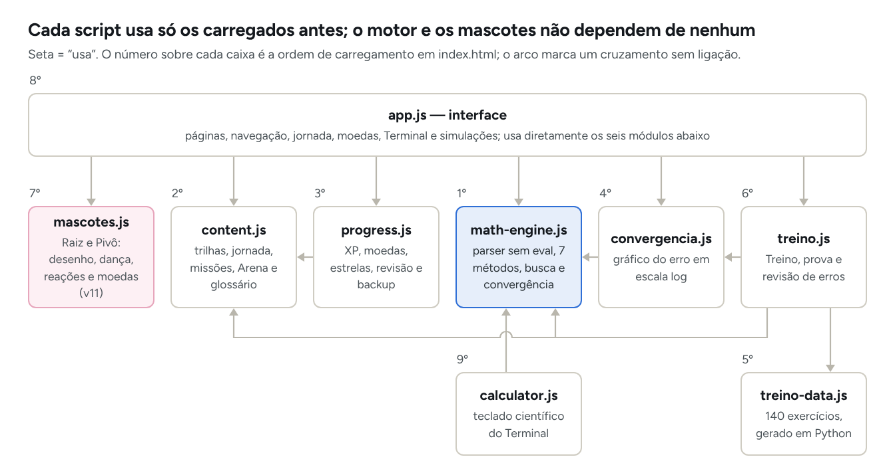
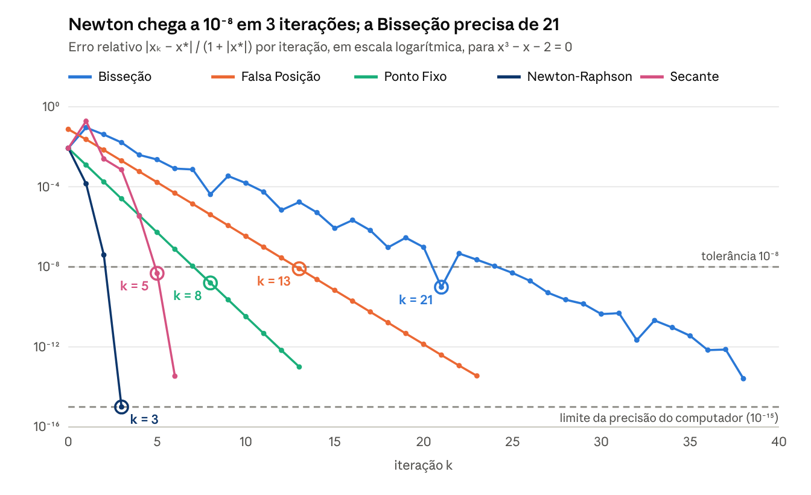

# Relatório técnico — Numera Academy

> Laboratório interativo de métodos numéricos · versão 12. Os números deste relatório vêm da última execução das suítes de teste (ver Apêndice A).

Rio de Janeiro, 26 de outubro de 2026

A Numera Academy (versão 12) é um jogo web para aprender métodos numéricos de Modelagem Computacional, organizado como uma jornada do método mais fácil ao mais difícil, com dois jogos: uma aventura 3D e um jogo de sala para o telão. Sua correção é sustentada por 1.994 verificações automáticas, 140 gabaritos calculados de forma independente, uma auditoria externa cujas falhas foram corrigidas e auditoria de acessibilidade sem violações.

**Autor:** Cauã De Angelis · Engenharia de Computação, Ibmec · Modelagem Computacional

## Resumo

Este relatório apresenta a Numera Academy, um site educativo que ensina métodos numéricos da disciplina de Modelagem Computacional: Bisseção, Falsa Posição, Newton-Raphson, Secante, Eliminação de Gauss e Gauss-Seidel, além do Ponto Fixo, implementado e guardado, mas escondido desde a versão 11 a pedido da professora. O projeto reúne uma jornada de seis mundos em ordem de dificuldade, com aulas em vídeo selecionadas, missões de modelagem, moedas e um casal de mascotes que reage ao desempenho; dois jogos, a Calculândia (aventura 3D) e o Quem Divergiu? (jogo de sala em que a turma estima, vota e confere o erro relativo na reta numérica); um Treino de diagnóstico com 120 exercícios visíveis, modo prova e um Terminal que resolve equações e sistemas lineares mostrando cada passo e o gráfico de convergência.

A implementação é um site estático em JavaScript, sem dependências em tempo de execução, com interpretador de expressões próprio (sem `eval`) e funcionamento offline. A validação combinou testes de propriedades do motor numérico, gabaritos calculados de forma independente com sympy e mpmath (50 dígitos), testes de interface em Chromium e WebKit, auditoria de acessibilidade WCAG 2.1 AA e integração contínua.

As 1.994 verificações automáticas passam, os 140 gabaritos coincidem com o motor do site e a auditoria de acessibilidade não encontrou violações em 42 telas. Depois de uma auditoria externa, o Terminal passou a certificar cada raiz antes de aceitá-la, o que impede apresentar como raiz um ponto de resíduo pequeno sem raiz por perto. Em x³ − x − 2 = 0, as ordens de convergência observadas (Bisseção 0,99; Newton 2,01; Secante 1,44) são compatíveis com a teoria. A eficácia educativa ainda não foi avaliada com alunos.

**Palavras-chave:** métodos numéricos; zeros de funções; sistemas lineares; jogo educativo; gamificação; validação de software.

## 1 Introdução

Métodos numéricos aproximam soluções que não têm fórmula fechada ou cuja fórmula é impraticável: a taxa de juros de um financiamento, a posição de um cometa na órbita, as temperaturas de uma placa. Na disciplina, o aluno precisa de três habilidades distintas: reconhecer quando cada método se aplica, executar as iterações e interpretar o resultado no problema real.

Exercícios tradicionais costumam informar o método no enunciado (“faça três iterações de Newton”), o que treina a execução, mas não a escolha. Calculadoras online fazem o oposto: entregam a resposta sem mostrar o caminho nem as condições de validade.

A Numera Academy foi construída para cobrir as três habilidades no mesmo ambiente. A versão 9 acrescentou a Falsa Posição e o Ponto Fixo aos cinco métodos anteriores, além do gráfico de convergência, do modo prova, das dicas por erro típico e da infraestrutura de testes automáticos, publicação e funcionamento offline. A versão 10 corrigiu as falhas apontadas por uma auditoria externa (seção 5.4) e acrescentou aulas em vídeo a cada método; a 10.1 pôs o intervalo [a, b] do exercício à vista no Terminal, usado por todos os métodos. A versão 11 atendeu a dois pedidos da professora: esconder o Ponto Fixo por enquanto e tornar a parte de jogo menos seca, com progressão por níveis de dificuldade e um personagem animado (seção 4.6). A versão 12, objeto deste relatório, trocou a Arena, fraca como jogo, por dois jogos: a Calculândia, aventura 3D feita pelo grupo, e o Quem Divergiu?, um jogo para a professora jogar com a turma na sala (seção 4.7).

## 2 Objetivos

**Objetivo geral:** desenvolver um ambiente web interativo que ensine a escolher, executar e interpretar métodos numéricos para zeros de funções e sistemas lineares, com resultados matematicamente verificados.

**Objetivos específicos:**

1. Implementar os sete métodos em um motor numérico próprio, com critérios de parada e mensagens de falha explícitos.
2. Interpretar expressões matemáticas digitadas pelo usuário sem executar código arbitrário (sem `eval`).
3. Oferecer prática em quatro níveis: lição guiada, simulação passo a passo, exercícios com feedback e problemas aplicados.
4. Treinar o diagnóstico do método com 140 exercícios misturados, cujo enunciado não revela o método antes da escolha.
5. Mostrar a convergência de forma visual, com o erro por iteração e a ordem observada de cada método.
6. Validar o motor e os gabaritos contra uma referência independente, com testes automatizados repetíveis.
7. Garantir acessibilidade (WCAG 2.1 AA), compatibilidade com os principais navegadores e uso offline.
8. Organizar a prática como um jogo com progressão do mais fácil ao mais difícil, recompensas que só premiam atividade nova e personagens que deem retorno imediato, sem prejudicar a acessibilidade nem a avaliação (v11).

## 3 Fundamentação teórica

Os sete métodos do motor dividem-se em cinco para zeros de funções reais, f(x) = 0, e dois para sistemas lineares, Ax = b. Na versão 11, o Ponto Fixo continua no motor e no conteúdo, mas não aparece no site (seção 4.6). A velocidade de um método iterativo é medida pela ordem de convergência p: com erro eₖ = |xₖ − x\*|, vale aproximadamente a relação abaixo, com C constante.

```math
e_{k+1} \approx C \, e_k^{\,p}
```

### 3.1 Zeros de funções

**Bisseção.** Se f é contínua em \[a, b\] e f(a)·f(b) < 0, o Teorema do Valor Intermediário garante uma raiz no intervalo. Toma-se o ponto médio e mantém-se a metade que preserva a troca de sinal. O erro cai pela metade a cada passo (ordem 1, fator 1/2), o que permite saber de antemão quantas iterações bastam para uma tolerância ε.

```math
x_k = \frac{a_k + b_k}{2}, \qquad n \ge \log_2 \frac{b - a}{\varepsilon}
```

**Falsa Posição (regula falsi).** Exige as mesmas condições da Bisseção, mas corta o intervalo onde a corda entre (a, f(a)) e (b, f(b)) cruza o eixo. Em curvas quase retas, gasta muito menos avaliações. Em curvas convexas ou côncavas, uma das pontas fica parada e a convergência é linear, às vezes lenta.

```math
x_k = \frac{a_k f(b_k) - b_k f(a_k)}{f(b_k) - f(a_k)}
```

**Ponto Fixo.** Reescreve-se f(x) = 0 como x = g(x) e itera-se a partir de um chute x₀. Se |g′(x)| ≤ L < 1 perto da raiz (g é uma contração), a sequência converge linearmente com fator aproximado |g′(x\*)|. Com g′ negativa os valores oscilam em volta da raiz; com |g′| > 1 a reescrita diverge.

```math
x_{k+1} = g(x_k), \qquad |g'(x^*)| < 1
```

**Newton-Raphson.** Segue a tangente até o eixo. Para raiz simples e chute suficientemente próximo, a convergência é quadrática: as casas corretas quase dobram a cada passo. Falha ou se desvia quando f′(xₖ) ≈ 0. É um caso particular do Ponto Fixo, com g′(x\*) = 0.

```math
x_{k+1} = x_k - \frac{f(x_k)}{f'(x_k)}
```

**Secante.** Troca a derivada pela inclinação entre as duas últimas aproximações. Precisa de dois pontos iniciais, que não precisam cercar a raiz, e não usa derivada. A ordem é a razão áurea, (1 + √5)/2 ≈ 1,618.

```math
x_{k+1} = x_k - f(x_k)\,\frac{x_k - x_{k-1}}{f(x_k) - f(x_{k-1})}
```

### 3.2 Sistemas lineares

**Eliminação de Gauss com pivoteamento parcial.** Método direto: zera os coeficientes abaixo da diagonal, escolhendo em cada coluna o maior pivô em módulo, e resolve o sistema triangular por retrossubstituição. Custa cerca de 2n³/3 operações e dá a solução em um número fixo de passos.

**Gauss-Seidel.** Método iterativo que atualiza cada incógnita usando os valores já calculados na mesma rodada. A dominância diagonal estrita de A é condição suficiente de convergência. Cada iteração custa cerca de 2n² operações, vantajoso em sistemas grandes ou esparsos.

```math
x_i^{(k+1)} = \frac{1}{a_{ii}} \Big( b_i - \sum_{j<i} a_{ij} x_j^{(k+1)} - \sum_{j>i} a_{ij} x_j^{(k)} \Big)
```

### 3.3 Quadro comparativo

| Método | Dados iniciais | Condição principal | Critério de parada no site | Ordem |
| --- | --- | --- | --- | --- |
| Bisseção | \[a, b\] | f contínua e f(a)·f(b) < 0 | \|f(x)\| ≤ tol | 1 (fator 1/2) |
| Falsa Posição | \[a, b\] | f contínua e f(a)·f(b) < 0 | \|f(x)\| ≤ tol | 1 |
| Ponto Fixo | x₀ e g | \|g′\| < 1 perto da raiz | \|x − g(x)\| ≤ tol | 1 (fator ≈ \|g′(x\*)\|) |
| Newton-Raphson | x₀ | f′ ≠ 0 e chute próximo | \|f(x)\| ≤ tol | 2 |
| Secante | x₀ e x₁ | f(x₀) ≠ f(x₁) | \|f(x)\| ≤ tol | ≈ 1,618 |
| Eliminação de Gauss | A e b | A não singular | direto (número fixo de passos) | — |
| Gauss-Seidel | A, b e x⁽⁰⁾ | dominância diagonal estrita (suficiente) | resíduo normalizado e variação ≤ tol | 1 |

## 4 Metodologia

O trabalho seguiu ciclos de versão (v5 a v11): implementar, testar contra uma referência independente, revisar o conteúdo e só então discutir melhorias. Esta seção descreve a arquitetura, o motor numérico, o desenho pedagógico, a geração do gabarito, as ferramentas e a gamificação.

### 4.1 Arquitetura

O site é estático: HTML, CSS e JavaScript puros, sem etapa de compilação, sem servidor e sem bibliotecas em tempo de execução. Nove scripts de aplicação são carregados em ordem fixa, e cada um expõe um objeto global usado pelos seguintes; um décimo, `sw-register.js`, só registra o service worker. O da v11, `mascotes.js`, desenha e anima o casal de mascotes e não depende de nenhum outro.



*Figura 1 — Arquitetura do site (v11): 9 scripts em `dist/`, dependências conferidas no código.*

Como o motor (destacado) não depende de nenhum outro script nem da página, ele é testado no Node sem navegador, e o mesmo arquivo serve ao Terminal, às simulações e ao Treino.

A interface usa delegação de cliques (atributo `data-act`), um objeto de estado único e uma função `render()` que redesenha a página. O progresso fica no `localStorage` do navegador; nada é enviado a servidor. Um service worker guarda os 30 arquivos do site (incluindo as fontes, empacotadas desde a v10) para uso offline, e a versão do cache é um resumo SHA-256 do conteúdo, então qualquer mudança invalida o cache antigo.

### 4.2 Motor numérico

- **Interpretador de expressões:** tokenização, árvore sintática e avaliação própria, sem `eval`. Aceita multiplicação implícita (2x), vírgula decimal e nomes em português (sen, tg).
- **Métodos:** cada execução devolve a tabela de iterações, o critério que a encerrou e observações (ponta parada na Falsa Posição, estimativa de |g′| no Ponto Fixo, tangente quase horizontal no Newton). Falhas param com mensagem, nunca com um número enganoso.
- **Certificação de raízes (v10):** quando |f(x)| ≤ tolerância, o motor procura uma troca de sinal em intervalos crescentes em volta de x, com valores acima do ruído de arredondamento estimado pela árvore da expressão. Sem troca de sinal, busca o mínimo de |f| por seção áurea: se ele chega ao nível do ruído, a raiz é aceita como provável de multiplicidade par; se não chega, o ponto é uma quase-raiz e é rejeitado. Essa conferência não entra no custo da comparação de métodos.
- **Intervalo do exercício (v10.1):** o intervalo [a, b] pode vir dos campos ou do fim da equação (`... em [0; 1]`). A Bisseção e a Falsa Posição o exigem, com f(a)·f(b) < 0; sem troca de sinal nas pontas, o Terminal aponta os sub-intervalos onde f troca de sinal. O Newton começa na ponta que satisfaz a condição de Fourier, f(x₀)·f″(x₀) > 0; a Secante, nas pontas; o Ponto Fixo, no ponto médio, com a checagem de max |g′| < 1 no intervalo. O automático procura só dentro de [a, b].
- **Busca automática:** 801 amostras em \[−40, 40\], refino em 64 partes perto de mínimos de |f| e até 400 candidatas. Bisseção, Falsa Posição, Newton e Secante são comparados, e vence a execução aceita com menos avaliações de f.
- **Convergência:** todos os métodos partem dos mesmos dados. O erro é medido contra uma raiz de referência polida por Newton, e a ordem observada é a inclinação da reta de mínimos quadrados de ln eₖ₊₁ contra ln eₖ.

### 4.3 Desenho pedagógico

| Componente | Função | Tamanho |
| --- | --- | --- |
| Jornada (trilhas) | mapa de mundos em ordem de dificuldade; em cada mundo, lição guiada (7 telas), simulação passo a passo e prática em três níveis (Fácil, Médio e Difícil) | 6 mundos × 12 etapas = 72 (84 com o Ponto Fixo) |
| Aulas em vídeo (v10) | outra explicação da mesma matéria: aulas públicas do YouTube, na trilha e no fim da lição | 3 por método (2 em português, 1 em inglês), 21 no total |
| Missões | problema aplicado em três etapas: formular, calcular, interpretar | 6 (7 com o Ponto Fixo) |
| Calculândia (v12) | aventura 3D: fases táticas com bateria, telemetria e dicas, chefões por região e a Usina | 63 fases, 21 métodos, 5 chefões |
| Quem Divergiu? (v12) | jogo de sala: estimar, votar em quem divergiu e conferir o erro relativo na reta | 30 perguntas + 23 relâmpago (os desafios da antiga Arena) |
| Treino | diagnosticar o método, resolver e conferir no gabarito | 120 exercícios visíveis (140 no arquivo), 369 erros típicos |
| Modo prova | sorteio, cronômetro, nota (0,4 pelo método e 0,6 pela resposta) e relatório em PDF | 5, 10 ou 15 questões |
| Revisão | revisão espaçada dos diagnósticos errados | intervalos de 1, 3, 7 e 14 dias |
| Terminal | resolve equações e sistemas com passos, convergência, verificação e modo guiado; intervalo [a, b] do exercício para todos os métodos | sistemas de 2 a 6 incógnitas |
| Mascotes, moedas e camarim (v11) | retorno imediato a acerto, erro, sequência de 3 acertos e nível concluído; moedas trocadas por roupas para os mascotes | 2 personagens, 5 reações, 6 roupas, 11 conquistas |

Duas escolhas têm base na literatura de aprendizagem. No Treino, os métodos vêm misturados e o enunciado só revela o método depois da escolha, porque praticar problemas embaralhados treina a discriminação entre procedimentos (ROHRER; TAYLOR, 2007). A revisão em intervalos crescentes segue o efeito da prática distribuída (CEPEDA et al., 2006).

### 4.4 Gabarito independente

Os 140 exercícios são produzidos por um gerador em Python que usa sympy (derivadas exatas e frações) e mpmath com 50 dígitos, ou seja, uma implementação diferente da do site. Cada exercício traz o enunciado com e sem o nome do método, a resposta com tolerância, os dados do gráfico de convergência e os erros típicos, calculados simulando o engano: uma iteração a menos, a metade errada do intervalo, calculadora em graus, Jacobi no lugar de Gauss-Seidel.

O motor do site refaz depois as 140 contas e confere que nenhum erro típico é aceito como resposta certa. O gerador é reproduzível byte a byte, e a ordem dos exercícios usa semente fixa, sem dois métodos iguais seguidos.

### 4.5 Ferramentas

| Ferramenta | Uso |
| --- | --- |
| JavaScript (ES2021), HTML e CSS | o site |
| Node.js | verificações do motor, do conteúdo e da interface em DOM simulado |
| Python 3, sympy e mpmath | gerador e gabarito do Treino |
| Playwright 1.56.1 (Chromium 141) | fluxos completos, celular, modo escuro, offline e impressão |
| axe-core 4.10 | auditoria de acessibilidade WCAG 2.1 AA |
| WebKitGTK 2.52 e Selenium | motor do Safari |
| acorn 8.14 | análise estática de compatibilidade com Safari 15, Firefox 90 e Chrome 90 |
| GitHub Actions | testes a cada envio e publicação no GitHub Pages |

### 4.6 Gamificação (v11)

A professora avaliou que a parte de jogo estava seca e sugeriu níveis de dificuldade, começando pelo básico, e um personagem que se movimente durante os desafios e faça algo diferente a cada três acertos seguidos. Também pediu para tirar o Ponto Fixo por enquanto. As decisões abaixo partem desses pedidos.

**Ordem dos mundos.** A dificuldade foi ordenada pelo que cada método exige de quem resolve, e não pela ordem dos capítulos: a Bisseção só pede o sinal de f (★); a Falsa Posição acrescenta a reta entre as pontas (★★); o Newton-Raphson exige a derivada e um bom chute (★★★); a Secante troca a derivada por dois pontos e perde a garantia de cerco (★★★); a Eliminação de Gauss é álgebra de matriz com pivotamento (★★★★); o Gauss-Seidel é iterativo e depende de um critério de convergência (★★★★★). Duas observações de pesquisa apoiaram a ordem. Num estudo com 68 estudantes, 77,9% acertaram a fórmula do Newton, mas só 34,8% o princípio da Secante, frequentemente confundido com a Falsa Posição (RACHMATIN; SUJANA, 2022): por isso a Secante vem depois do Newton. E derivadas são um ponto fraco frequente de estudantes de engenharia (DÍAZ QUEZADA, 2020): por isso o Newton fica depois dos métodos de cerco. A ordem é uma hipótese, declarada no próprio site ("Por que essa ordem?"), e o modo livre permite estudar fora dela.

**Travas.** O mundo seguinte abre ao concluir o Nível 1 do anterior (4 etapas), não o mundo inteiro, para que a trava guie sem prender. A leitura e a simulação de um mundo fechado ficam liberadas, e quem já tinha progresso num mundo não perde o acesso ao atualizar.

**Recompensas.** Moedas por etapa nova (+2), etapa de missão (+5), sequência de 3 acertos (+5), nível (+10) e mundo (+30). Para não premiar a repetição mecânica, nenhuma recompensa se repete: refazer etapas não paga, e o bônus de sequência exige ao menos uma atividade nova desde o anterior. As moedas compram roupas para os mascotes no camarim, uma recompensa puramente estética, que não altera a nota, o XP nem o acesso ao conteúdo.

**Personagens.** Raiz (um rabanete, a raiz que se procura em toda equação) e Pivô (um bloco de matriz com luvas de boxe, o pivô da Eliminação de Gauss) são desenhos originais em SVG, animados com CSS e Web Animations, sem bibliotecas. Dançam enquanto a pessoa pensa e reagem ao acerto, ao erro, à sequência de três acertos (o Pivô soca a caixa Σ e caem moedas que voam até o contador) e ao fim de um nível ou mundo (confete). A meta-análise de Sailer e Homner (2020) encontrou efeitos pequenos e significativos da gamificação sobre a aprendizagem cognitiva (g = 0,49; 19 estudos), a motivação (g = 0,36; 16 estudos) e o comportamento (g = 0,25; 9 estudos), e a ficção de jogo (narrativa e personagens) foi um moderador significativo do efeito comportamental. O casal é a ficção de jogo deste projeto.

**Cuidados.** Os mascotes são decorativos para leitor de tela (`aria-hidden`), e tudo o que comunicam aparece também em texto e é anunciado. Ficam parados com "reduzir movimento" ligado no sistema e não aparecem no Treino nem no modo prova, para não distrair na avaliação. No celular ficam menores e a página reserva espaço para que não cubram o botão de responder.

**Ponto Fixo escondido.** Uma lista em `content.js` (`C.HIDDEN`) filtra o método das trilhas, missões, Treino, prova, Terminal, glossário e do Quem Divergiu?, sem apagar o motor, o conteúdo nem o progresso já salvo (os identificadores não mudam). Esvaziar a lista o traz de volta como Mundo 3; os testes conferem os dois estados.

### 4.7 Jogos (v12)

A Arena era uma lista de desafios com vidas e sequência, e a turma a achou fraca como jogo. No lugar dela entrou a página Jogos, com dois jogos de propósitos diferentes: um para estudar sozinho, explorando, e outro para a sala inteira jogar junto.

**Calculândia — Caçadores de Raízes.** Aventura 3D em Three.js feita pelo grupo, integrada ao site sem mudar as regras:
- uma ilha com seis regiões, 28 assentamentos, 63 fases táticas de 21 métodos, cinco chefões e a Usina;
- cada fase tem bateria, telemetria do erro, dicas em três níveis e desfazer.

A integração cuidou de três pontos:
1. **Nada vem de fora do site:** o Three.js 0.160.0 e a fonte saem do próprio site, a página tem política de segurança (CSP) e o jogo abre sem CDN.
2. **Offline sem pesar no site:** o service worker guarda os arquivos do jogo (≈ 1,5 MB) na primeira vez que ele abre, e não no primeiro acesso ao site.
3. **Progresso à vista:** a página Jogos lê o salvamento do jogo, com cada campo conferido, para mostrar estrelas, fases vencidas e Raízes Fugitivas e para dar a conquista Caçador de Raízes.

Os testes do jogo (regras das fases, todas as fases abrindo no navegador e alcance de todas as portas do mapa) passaram a rodar no CI.

**Quem Divergiu?** Jogo de sala para o telão, adaptado da dinâmica de jogos de festa: pergunta com resposta numérica, palpites em segredo, votação em quem "errou feio" e revelação. Cada parte da dinâmica foi ligada a um conceito da matéria:

| Dinâmica | O que a turma pratica |
| --- | --- |
| Pergunta da matéria com resposta numérica (um passo de Newton, um corte da Falsa Posição, o y⁽¹⁾ do Gauss-Seidel, o custo da eliminação) | executar ou estimar o método |
| Palpite em segredo, no caderno ou passando o aparelho | estimar antes de calcular |
| Voto em quem divergiu | julgar a ordem de grandeza dos palpites |
| Reta numérica com faixas de erro relativo de 1%, 5% e 20% | erro relativo e tolerância, o critério de parada dos métodos |
| "Como se calcula" no quadro | o passo a passo, para a professora explicar |

Detalhes do jogo:
- **Respostas calculadas:** cada resposta é calculada em código, com implementações próprias e curtas dos métodos, e conferida nos testes contra o motor do site.
- **Desafios da antiga Arena:** os 23 desafios numéricos entraram como perguntas relâmpago, com a explicação que já tinham.
- **Pontuação:** recompensa a proximidade e acrescenta dois elementos sociais: o voto certeiro e o "injustiçado", votado sem ter divergido. Competição com colaboração foi a combinação que Sailer e Homner (2020) associaram a efeitos maiores sobre o comportamento.
- **Sala de aula real:**
  - funciona num computador só, sem servidor nem conta;
  - cabe num projetor de 720 linhas e respeita "reduzir movimento";
  - anuncia cada fase para leitor de tela;
  - lê palpites com vírgula ou ponto, frações e notação científica, e mostra como leu cada número.

## 5 Validação e resultados

Todas as suítes passam na versão 12: 1.994 de 1.994 verificações, 0 divergências entre o gabarito independente e o motor e 0 violações de acessibilidade. As mesmas suítes rodam no GitHub Actions a cada envio, e o site só é publicado se todas passarem.

### 5.1 Testes automatizados

| Suíte | O que confere | Resultado |
| --- | --- | --- |
| Verificações gerais (Node) | interpretador, propriedades dos 7 métodos, entradas inválidas, busca automática, sistemas em escalas de 10⁻²⁰ a 10¹⁵, convergência, conteúdo, progresso, interface em DOM simulado, Treino, prova, revisão, PWA, regressões da auditoria externa, intervalo no Terminal, expoentes elevados e gamificação (método escondido e preservado, ordem e travas, moedas, mascotes, camarim)  e jogos (página Jogos e Quem Divergiu?, com cada resposta conferida contra o motor) | 1.994 / 1.994 |
| Gabarito do Treino | as 140 respostas (sympy/mpmath) refeitas pelo motor; nenhum dos 369 erros típicos aceito; 140 gráficos | 0 divergências |
| Gerador reproduzível | o arquivo publicado é idêntico ao que o gerador produz | idêntico |
| Terminal no navegador | 100 equações digitadas tecla por tecla e 19 cenários do teclado científico | 100 / 100 e 19 / 19 |
| Terminal no motor | 1.000 polinômios e 400 equações transcendentes aleatórias, comparadas raiz a raiz com sympy e mpmath | 1.000 / 1.000 e 398 / 400 (2 erros da referência, explicados) |
| Fluxos completos (Chromium) | trilhas, missões, Terminal, Treino, prova, impressão, só teclado, celular, modo escuro, quase-raiz, aulas em vídeo, prova encerrada pelo tempo, intervalo no Terminal, jornada com travas, combo com moedas, camarim, página Jogos, uma partida inteira do Quem Divergiu? e a Calculândia sem pedidos para fora do site | 118 / 118 |
| Offline (PWA) | service worker, 36 arquivos em cache, cálculo, fontes e os dois jogos sem internet | 14 / 14 |
| Acessibilidade (axe-core) | regras WCAG 2.0/2.1 A e AA em 42 telas (10 delas do Quem Divergiu? e a inicial da Calculândia), temas claro e escuro | 0 violações |
| Motor do Safari (WebKit) | scripts, páginas, teclado científico, convergência, jornada, animações dos mascotes, Treino, prova e uma rodada do Quem Divergiu? | 33 / 33 |
| Compatibilidade (acorn) | código ES2021 sem recursos ausentes em Safari 15, Firefox 90 e Chrome 90; módulos da Calculândia válidos e sem importação externa | 536 / 536 |
| Calculândia (Node e Chromium) | regras das 63 fases, chefões e Usina; as 69 montagens de fase no navegador; todas as portas alcançáveis a pé | 79 / 79, sem erros |

### 5.2 Convergência observada

O caso de referência é x³ − x − 2 = 0, com raiz x\* ≈ 1,5213797068. Todos os métodos partem dos mesmos dados: intervalo \[1; 2\], x₀ = 1,5, x₁ = 2 e, no Ponto Fixo, g(x) = ∛(x + 2). A ordem observada concorda com a teoria: cerca de 1 nos três métodos lineares, 2,01 no Newton e 1,44 na Secante, que com apenas três pontos úteis fica abaixo do valor teórico de 1,618.



*Figura 2 — Erro relativo por iteração, calculado pelo motor do site (v9): intervalo [1; 2], x₀ = 1,5, x₁ = 2 e g(x) = ∛(x + 2). O Ponto Fixo continua no motor; só não aparece no site da v11.*

Os métodos de ordem 1 descem em reta, com inclinação dada pelo fator de redução; Newton e Secante descem cada vez mais rápido. O círculo marca a primeira iteração com erro abaixo de 10⁻⁸.

| Método | Ordem teórica | Ordem observada | Fator teórico | Fator observado |
| --- | --- | --- | --- | --- |
| Newton-Raphson | 2 | 2,01 | — | — |
| Secante | ≈ 1,618 | 1,44 | — | — |
| Ponto Fixo | 1 | 1,00 | \|g′(x\*)\| = 1/(3x\*²) ≈ 0,144 | 0,14 |
| Falsa Posição | 1 | 1,00 | 1 − f′(x\*)(b − x\*)/f(b) ≈ 0,289 | 0,29 |
| Bisseção | 1 | 0,99 | 1/2 (cota do erro) | 0,53 |

Os fatores teóricos usam x\* ≈ 1,5214. Na Falsa Posição, a ponta b = 2 fica parada porque f é convexa em \[1; 2\]. Na Bisseção, 1/2 é o fator da cota (b − a)/2ᵏ; o erro em si oscila, porque o ponto médio pode passar perto da raiz por acaso, como em k = 21, e depois se afastar.

Na comparação de custo do Terminal, com tolerância 10⁻⁶, vence a Secante: 6 avaliações de f, contra 7 do Newton (que gasta duas avaliações extras por derivada), 15 da Falsa Posição e 24 da Bisseção.

Em sistemas, no exemplo diagonalmente dominante 10x − y + 2z = 6, −x + 11y − z = 25, 2x − y + 10z = −11, o Gauss-Seidel chega ao erro relativo 10⁻⁸ em 6 iterações, e o Jacobi, mostrado só como referência, em 13.

### 5.3 Acessibilidade e navegadores

A auditoria encontrou 32 falhas no início da v9, todas corrigidas: contraste do texto secundário (de 2,8:1 para 4,5:1), estado de foco do botão Resolver, transparência nas etapas bloqueadas e rótulos ARIA sem papel. O gráfico de convergência é operado pelo teclado e tem tabela com os números, para que a cor nunca carregue a informação sozinha.

O site foi executado de fato no Chromium 141 e no WebKitGTK 2.52, o mesmo motor do Safari. O Firefox foi verificado apenas por análise estática, porque não pôde ser instalado no ambiente de testes.

Na v10, o foco passou a ser preservado depois de cada redesenho da página e uma região `aria-live` anuncia os eventos da prova (início, troca de questão, 5 e 1 minuto restantes, fim pelo tempo). No gráfico de convergência, o desfecho de cada série aparece em texto e com traço diferente, não só pela cor.

Na v11, a auditoria passou a cobrir o mapa da jornada (com e sem modo livre), um mundo travado, um acerto com os mascotes em cena e o camarim. Na v12, entraram a página Jogos, as dez telas do Quem Divergiu? (inclusive a revelação na reta, cuja imagem tem descrição completa com cada palpite e seu erro) e a tela inicial da Calculândia. Cada mundo do mapa tem rótulo completo para leitor de tela, as estrelas de dificuldade têm texto alternativo e o modo livre é um interruptor acessível (`role="switch"`).

### 5.4 Auditoria externa (v10)

Uma auditoria independente da v9 (Manus, 17 de outubro de 2026) encontrou falhas que as suítes anteriores não cobriam. Todas as falhas classificadas como críticas foram reproduzidas, corrigidas e ganharam testes de regressão (90 verificações novas e 17 nos fluxos do navegador):

| Falha | Exemplo | Correção |
| --- | --- | --- |
| Resíduo pequeno aceito como raiz | 10⁻²⁰·(x² + 1) = 0 tinha "raiz" em x = 0 | certificação local (seção 4.2); quase-raiz rejeitada e gráfico com escala própria |
| Sistema reescalado rejeitado | 10⁻²⁰·x = 10⁻²⁰, y = 1 era "sem solução única" | equilíbrio de linhas e colunas antes do teste de posto; mensagens distintas e número de condição κ∞ |
| Trajetória parcial parecendo convergência | série que parou no limite de iterações, desenhada como as demais | desfecho por série: convergiu, parcial, divergiu, falhou |
| Backup incompleto | o arquivo não trazia Treino, provas nem revisões | backup único versionado |
| Prova expirada sem relatório | o cronômetro zerava e nada acontecia | encerramento automático, relatório e anúncio |
| Gabarito aberto contado como resolvido | o tabuleiro superestimava a autonomia | estado "visto com ajuda" |
| Falha de gravação mascarada | "importado" aparecia mesmo com o armazenamento bloqueado | gravação confirmada antes da mensagem |
| Dependência de teste vulnerável | Playwright 1.48 | Playwright 1.56.1, `npm audit` sem vulnerabilidades |

A auditoria também propôs modularizar a interface, onboarding por objetivo, modo professor e um piloto com alunos; esses itens ficaram como trabalhos futuros (seção 7). A resposta completa, item a item, está em `RESPOSTA-A-AUDITORIA.md`.

## 6 Limitações

O site fornece aproximações verificadas por critérios declarados, dentro de um escopo restrito; ele não prova existência nem unicidade de raízes para funções gerais.

- **Escopo:** raízes reais de equações de uma variável e sistemas lineares quadrados de 2 a 6 incógnitas. Não há EDOs, integração, interpolação, raízes complexas nem álgebra simbólica.
- **Busca automática amostrada:** não encontrar uma raiz não prova que ela não existe. Raízes mais próximas que cerca de 0,003, oscilações mais rápidas que a amostragem e escalas extremas podem escapar.
- **Resíduo não é erro:** resíduo pequeno pode coexistir com erro maior em x, em raízes múltiplas e em matrizes mal condicionadas. A certificação de raízes é local e, abaixo do arredondamento, não separa uma raiz dupla de uma equação que quase a tem: a segunda pode aparecer como "raiz provável de multiplicidade par", nunca como raiz certificada.
- **Aulas em vídeo:** dependem do YouTube e de internet; foram escolhidas e conferidas pelo título e pelo canal, não avaliadas com alunos. Um vídeo pode ser removido pelo autor.
- **Escolhas de implementação:** o Newton usa derivada por diferenças centrais, não simbólica; a Falsa Posição é a clássica, sem a modificação de Illinois; no Ponto Fixo, a função g é escolhida pelo usuário e o método não entra na comparação automática.
- **Critério de parada:** todos os métodos param por |f(x)| ≤ ε. O critério da largura do intervalo, comum nos livros para a Bisseção, só é mostrado (n ≥ log₂((b − a)/ε)), não aplicado; o número de iterações pode diferir do de um exercício resolvido à mão.
- **Ordem observada:** com poucos pontos úteis, como no Newton e na Secante, é uma estimativa.
- **Navegadores:** o Firefox não foi executado, só analisado estaticamente; o Safari foi representado pelo WebKitGTK, não pelo Safari do macOS ou do iOS.
- **Acessibilidade:** a auditoria é automática; não houve testes com pessoas usando leitores de tela.
- **Gamificação:** a ordem de dificuldade é uma hipótese apoiada em dois estudos e na análise do que cada método exige, não uma medida feita com a turma. Moedas e roupas não têm valor fora do site e ficam só no navegador. O efeito dos mascotes sobre a motivação não foi medido.
- **Jogos:** o Quem Divergiu? roda num computador só (a professora digita os palpites ou a turma passa o aparelho); cada aluno jogar no próprio celular exigiria um servidor de tempo real. A Calculândia exige WebGL 2 e navegadores mais novos (Chrome/Edge 98, Firefox 94, Safari 15.4); foi testada no Chromium com WebGL por software, não em celulares nem em placas de vídeo variadas.
- **Eficácia educativa:** não foi medida com alunos. Os testes comprovam a correção do software e do conteúdo, não o ganho de aprendizagem.
- **Dados locais:** o progresso fica em um único navegador, sem sincronização entre dispositivos; o backup em JSON é manual.
- **Cabeçalhos de segurança:** a política de segurança (CSP) e a Referrer-Policy estão na página, mas `Permissions-Policy` e `X-Content-Type-Options` exigem cabeçalhos HTTP, que o GitHub Pages não permite configurar.

## 7 Conclusão e trabalhos futuros

Os objetivos foram atingidos no plano do software. Na v11, a prática virou uma jornada com dificuldade crescente, travas leves, recompensas que só premiam atividade nova e um casal de mascotes que dá retorno imediato; o Ponto Fixo saiu do site sem sair do projeto. Na v12, a Arena deu lugar à Calculândia e ao Quem Divergiu?, que leva a matéria para um jogo da turma inteira. Além disso, os sete métodos estão implementados com critérios explícitos e cada raiz é certificada antes de ser aceita, o Treino exercita a escolha do método antes da execução, o gráfico de convergência torna visível a diferença entre ordem 1 e ordem 2, e a correção foi conferida contra uma referência independente em todas as 140 respostas. O site é acessível pelo critério WCAG 2.1 AA automatizado, funciona offline e está pronto para publicação com testes contínuos.

A principal lacuna é a evidência de aprendizagem. Os próximos passos, em ordem de prioridade:

1. Avaliar com uma turma da disciplina: pré-teste e pós-teste de diagnóstico de método, um questionário de usabilidade e de motivação, e a taxa de erro por mundo, para confirmar ou ajustar a ordem de dificuldade.
2. Gamificação, segunda etapa: Quem Divergiu? com cada aluno no próprio celular (exige um servidor de tempo real), um chefe por mundo na jornada, missões diárias, ranking da turma com equipes, proteção de sequência e falas dos mascotes por mundo.
3. Publicar no GitHub Pages e recolher relatos de uso.
4. Testar no Firefox e no Safari reais e com leitores de tela (NVDA e VoiceOver).
5. Produto, a partir da auditoria externa: onboarding por objetivo, modo Essencial/Aprofundado no gabarito, navegação mais curta no celular, mapa de competências e modo professor (provas por semente e exportação em CSV).
6. Engenharia: separar `app.js` em módulos e acrescentar regressão visual por capturas de tela.
7. Critério de parada à escolha (|f(x)|, largura do intervalo ou variação entre aproximações), alinhado ao material da disciplina.
8. Acrescentar a Falsa Posição modificada (Illinois), o Jacobi como método completo e a derivada simbólica no Newton.
9. Estender o conteúdo a outros temas da disciplina, como interpolação, integração numérica e EDOs (Euler e Runge-Kutta).

## Referências

BARRETT, R. et al. **Templates for the solution of linear systems:** building blocks for iterative methods. Philadelphia: SIAM, 1994. Disponível em: <https://www.netlib.org/linalg/html_templates/Templates.html>.

BURDEN, R. L.; FAIRES, J. D.; BURDEN, A. M. **Análise numérica**. Tradução da 10. ed. norte-americana. São Paulo: Cengage Learning, 2016.

CEPEDA, N. J. et al. Distributed practice in verbal recall tasks: a review and quantitative synthesis. **Psychological Bulletin**, v. 132, n. 3, p. 354–380, 2006. DOI: [10.1037/0033-2909.132.3.354](https://pubmed.ncbi.nlm.nih.gov/16719566/).

CHAPRA, S. C.; CANALE, R. P. **Métodos numéricos para engenharia**. 7. ed. Porto Alegre: AMGH, 2016.

DÍAZ QUEZADA, V. Difficulties and performance in mathematics competences: solving problems with derivatives. **International Journal of Engineering Pedagogy**, v. 10, n. 4, p. 35–53, 2020. DOI: [10.3991/ijep.v10i4.12473](https://online-journals.org/index.php/i-jep/article/view/12473).

DRISCOLL, T. A.; BRAUN, R. J. **Fundamentals of numerical computation**. Philadelphia: SIAM, 2017. Disponível em: <https://fncbook.com>.

RACHMATIN, D.; SUJANA, A. Analysis of student difficulty in understanding the roots of nonlinear equations. In: INTERNATIONAL CONFERENCE ON ELEMENTARY EDUCATION, 4. (ICEE-4), 2022, Bandung. **Proceedings** […]. Bandung: Universitas Pendidikan Indonesia, 2022. Disponível em: <https://proceedings.upi.edu/index.php/icee/article/download/1979/1826>.

ROHRER, D.; TAYLOR, K. The shuffling of mathematics practice problems boosts learning. **Instructional Science**, v. 35, n. 6, p. 481–498, 2007. DOI: [10.1007/s11251-007-9015-8](https://digitalcommons.usf.edu/psy_facpub/1767/).

RUGGIERO, M. A. G.; LOPES, V. L. R. **Cálculo numérico:** aspectos teóricos e computacionais. 2. ed. São Paulo: Makron Books, 1996.

SAILER, M.; HOMNER, L. The gamification of learning: a meta-analysis. **Educational Psychology Review**, v. 32, n. 1, p. 77–112, 2020. DOI: [10.1007/s10648-019-09498-w](https://doi.org/10.1007/s10648-019-09498-w).

W3C. **Web Content Accessibility Guidelines (WCAG) 2.1**. 2018. Disponível em: <https://www.w3.org/TR/WCAG21/>.

## Apêndice A — Como reproduzir os testes

Na pasta do projeto, com Node.js 18 ou mais novo e Python 3 com sympy e mpmath:

```bash
npm run testar                       # 1.994 verificações, gabarito do Treino, cache offline e regras da Calculândia
python3 tests/treino/gerar-treino.py /tmp/t.js && cmp /tmp/t.js dist/treino-data.js
npm run servir                       # em outro terminal: site em http://127.0.0.1:8000
(cd tests/e2e && npm install)        # uma vez: Playwright, axe-core e acorn
npm run testar-navegador             # compatibilidade, fluxos, offline e acessibilidade
xvfb-run -a python3 tests/e2e/testar-webkit.py http://127.0.0.1:8000/   # motor do Safari (Linux)
```

O procedimento completo dos testes do Terminal está em `TESTES-TERMINAL.md`, e o de cada suíte, em `QUALIDADE.md`.
